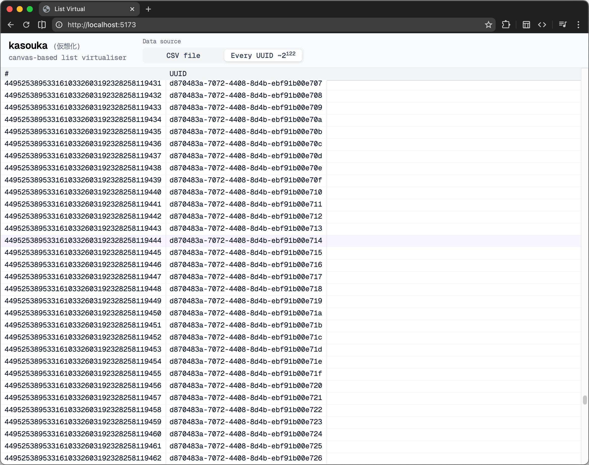

# kasouka

virtual canvas table for large datasets — silky-smooth scrolling through millions of rows, zero dom overhead.



## install

```sh
bun add kasouka
# or
npm install kasouka
```

## quickstart

you need three elements: a scrollable **viewport**, a **spacer** div inside it (sets the scroll height), and a **canvas** fixed on top.

```html
<div id="viewport" style="position:relative; width:100%; height:600px; overflow:auto;">
  <div id="spacer"></div>
  <canvas id="layer" style="position:fixed; top:0; left:0; pointer-events:none;"></canvas>
</div>
```

```ts
import { VirtualCanvasTable } from "kasouka";
import { ExampleVirtualDataSource } from "kasouka/datasource/virtual";

const table = new VirtualCanvasTable(
  {
    viewport: document.getElementById("viewport")!,
    spacer: document.getElementById("spacer")!,
    canvas: document.getElementById("layer") as HTMLCanvasElement,
  },
  {
    header: { background: "#f3f4f6", text: "#111827", border: "#d1d5db", height: 24 },
    cells: { background: "#ffffff", text: "#111827", height: 24 },
    bottomRow: { enabled: true, modules: ["scroll-position", "total-rows"] },
  }
);

// plug in a data source — here's a virtual one with 10 million rows
table.setDataSource(new ExampleVirtualDataSource({ rows: 10_000_000 }));
```

### custom data source

implement the `DataSource` interface to hook in any backend:

```ts
import type { DataSource } from "kasouka/datasource/index";

const mySource: DataSource = {
  getColumns: () => [
    { key: "id", label: "#", min: 60, align: "right" },
    { key: "name", label: "name", min: 200 },
  ],
  getRowCount: () => myData.length,
  getRow: (i) => [String(i), myData[i].name],
  sampleRows: function* (max) { for (let i = 0; i < Math.min(max, myData.length); i++) yield this.getRow(i); },
};

table.setDataSource(mySource);
```

### csv

```ts
import { makeCsvData } from "kasouka";
import { CsvDataSource } from "kasouka/datasource/csv";

const csv = makeCsvData(await file.text());
table.setDataSource(new CsvDataSource(csv));
```

## features

- silky-smooth canvas-based rendering — no dom row virtualization
- millions of rows, smooth scrolling (bigint row indices, no precision loss)
- datasource abstraction — swap backends without touching the table
  - `ExampleVirtualDataSource` — virtual rows derived from index
  - `EveryUUIDVirtualDataSource` — all 2^122 uuids
  - `CsvDataSource` — small-to-medium csv files (web worker support coming soon)
- hover + click row highlighting with easing
- sticky header and configurable status bar (scroll %, row count, custom links)
- dpr-aware canvas scaling, auto-resizes on window resize

## demo

check out [`demos/vanilla`](https://kasouka.vercel.app) for a live example

## license

mit
